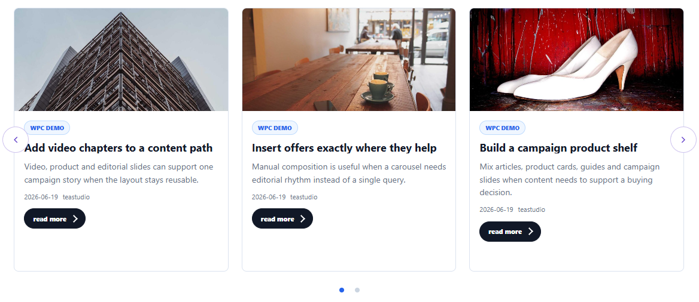

# Related Content for CCI Posts Carousel All In One

Help visitors find the next relevant article or product. Related Content fills a CCI Posts Carousel All In One row from the page being viewed, using shared public categories and tags or WooCommerce's related-product matches.

[Product and download](https://coolcatideas.com/products/cci-posts-carousel-related-content/) · [Developer guide](docs/1.0.0/developer.md) · [Support](https://github.com/cool-cat-ideas/related-content-for-cci-posts-carousel/issues)

## See what you can build

Place a carousel on an article or product page and let the current page determine the recommendations. Related Content selects the items; the main plugin and its chosen template render the cards.

## Show related content

1. Install and activate CCI Posts Carousel All In One 2.0.0 or newer.
2. Install and activate Related Content.
3. Edit a query-based carousel and select **Related to the current post or product** under **Order by**.
4. Place the saved carousel on an individual post or product page.
5. Check that the current page shares public categories or tags with other published items.

The extension works with the base carousel plugin without Pro or a license key. It also works without Yoast SEO and WooCommerce.

## How matching works

- Posts and pages are matched through shared public terms. The Yoast SEO primary category is prioritized when available.
- Product-only carousels on product pages use WooCommerce's native related-product matches, then shared terms as a fallback.
- The current item is excluded from its own recommendations.

Optional WooCommerce prices, ratings and cart actions come from the main CCI Posts Carousel All In One Pro package. Related Content itself does not require Pro.

## Customize and extend

The [developer guide](docs/1.0.0/developer.md) explains the reference-item and query filters, with examples.

## Support and license

Use [GitHub issues](https://github.com/cool-cat-ideas/related-content-for-cci-posts-carousel/issues) for public questions and bug reports. See the [changelog](CHANGELOG.md) for release history.

GPL-2.0-or-later. See [LICENSE](LICENSE).
